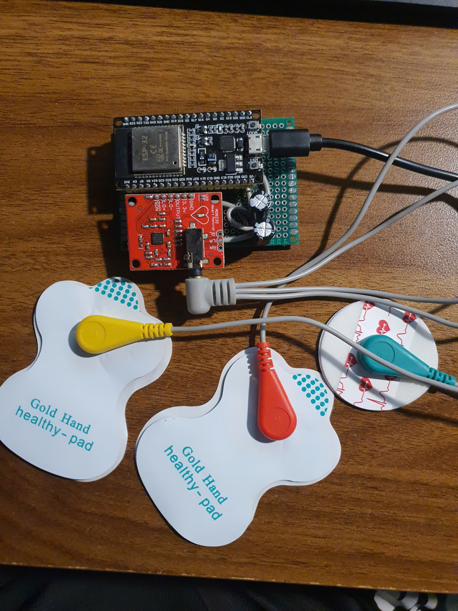
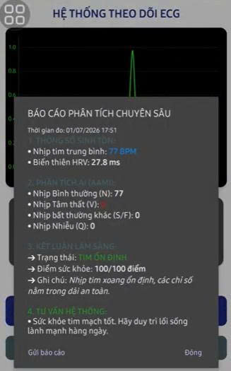

# Nghiên cứu ứng dụng TinyML trong Phát hiện và Cảnh báo Rối loạn Nhịp tim trên Thiết bị Biên 🚀

[](https://www.edgeimpulse.com/)
[](https://www.espressif.com/)
[](https://mqtt.org/)
[](https://developer.android.com/)

Hệ thống IoMT (Internet of Medical Things) giám sát nhịp tim thời gian thực, tích hợp mô hình học sâu **1D-CNN** đã qua lượng tử hóa để suy luận trực tiếp trên vi điều khiển ESP32. Dự án giải quyết bài toán độ trễ và bảo mật dữ liệu y tế bằng cách xử lý AI tại biên.

---

## 🌟 Điểm nhấn Kỹ thuật (Technical Highlights)

- **AI Optimization:** Triển khai mạng nơ-ron tích chập 1 chiều (**1D-CNN**) huấn luyện trên tập dữ liệu MIT-BIH. Mô hình được lượng tử hóa **Int8**, nén từ 124KB xuống **56KB**, tốc độ suy luận cực nhanh (**5ms**).
- **Embedded RTOS:** Sử dụng hệ điều hành **FreeRTOS** để phân tải đa nhân (Dual-core):
  - `Core 1`: Thu thập tín hiệu 500Hz, lọc nhiễu số (Notch Filter 50Hz).
  - `Core 0`: Chạy bộ suy luận AI và truyền thông MQTT SSL/TLS.
- **Smart App Logic:** Ứng dụng Android tích hợp tầng hậu xử lý **Strategic Bio-Verification (SBV)** giúp đối soát nhãn AI với nhịp tim sinh học thực tế, giảm thiểu tối đa báo động giả do nhiễu cử động (EMG).
- **Security:** Mã hóa toàn bộ đường truyền dữ liệu qua MQTT SSL (Port 8883) và xác thực ẩn danh trên Firebase Cloud.

---

## 📁 Cấu trúc Dự án

```text
├── android-app/         # Mã nguồn ứng dụng Android (Java, MPAndroidChart, MQTT Client)
├── esp32-firmware/      # Firmware C++ (FreeRTOS, TensorFlow Lite Micro, DSP Filter)
├── python-processing/   # Script Python tiền xử lý dữ liệu và phân tích tín hiệu
├── assets/              # Hình ảnh thực tế, sơ đồ mạch và kết quả thực nghiệm
└── .gitignore           # Bộ lọc rác cho dự án Android và C++
```
🛠 Công nghệ sử dụng
Thành phần	Công nghệ
Vi điều khiển	ESP32 (Dual-core 240MHz)
Cảm biến	AD8232 ECG Sensor
Framework AI	Edge Impulse, TensorFlow Lite for Microcontrollers
Mobile App	Android Studio (Java), Firebase Realtime DB
Giao thức	MQTT SSL/TLS, JSON
Xử lý tín hiệu	Digital Notch Filter (IIR bậc 2), Zero-padding

📊 Kết quả thực nghiệm
Độ chính xác (Accuracy): 96.91% trên tập dữ liệu kiểm thử độc lập.
Độ trễ End-to-end: ~1 giây (Đáp ứng tiêu chuẩn giám sát thời gian thực).
Hiệu suất RAM: Chỉ chiếm ~1.5% tổng dung lượng RAM của ESP32.

📸 Hình ảnh Dự án
<div align="center">


<p><i>Hình 1: Mô hình phần cứng và Giao diện giám sát thời gian thực</i></p>
</div>
👥 Nhóm thực hiện
Sinh viên: Nguyễn Hữu Duy & Nguyễn Đại Minh Huy.
Giảng viên hướng dẫn: ThS. Nguyễn Quốc Khoa.
Đơn vị: Khoa Điện tử - Viễn thông, Trường ĐH Khoa học Tự nhiên - ĐHQG TP.HCM.
Dự án này là kết quả của Khóa luận tốt nghiệp năm 2026.